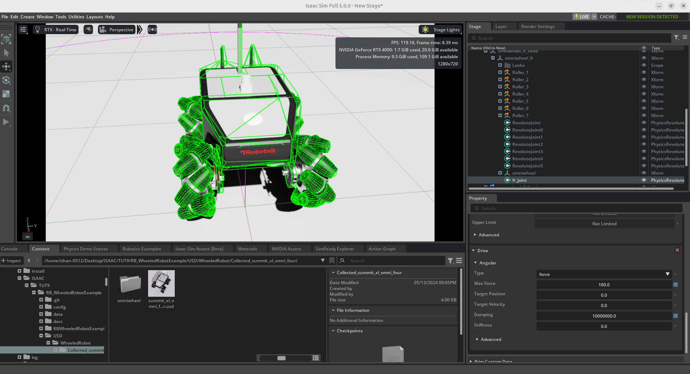
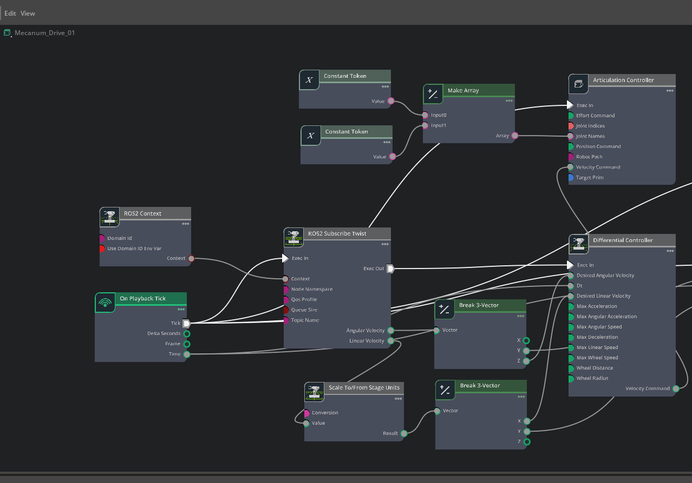
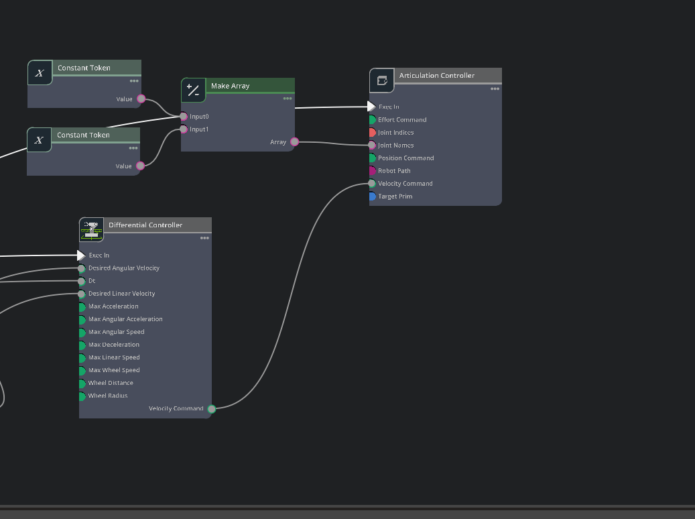

# Isaac Sim Mecanum Drive Control with ROS 2 and Joystick

A documented Isaac Sim project for controlling a Robotnik-style mecanum-wheel mobile robot from a physical joystick through ROS 2 and an Isaac Sim OmniGraph control pipeline.

The project contains the Isaac Sim stage, the ROS 2 joystick teleoperation script, OmniGraph screenshots, and a demonstration recording.

## Project Overview

The control chain is:

```text
Physical Joystick
      |
      v
Python Teleoperation Node
      |
      | ROS 2 geometry_msgs/msg/Twist
      v
/cmd_vel
      |
      v
Isaac Sim ROS 2 Subscribe Twist
      |
      v
Velocity / Vector Processing
      |
      v
Mecanum Differential Controller
      |
      v
Articulation Controller
      |
      v
Mecanum Robot Wheels
```

The supplied joystick program publishes `Twist` messages to `/cmd_vel` at 20 Hz and applies a joystick deadzone of `0.05`. The supplied Isaac Sim graph contains the ROS 2 context, Twist subscriber, vector-processing nodes, a differential controller, and an articulation controller.

## Repository Structure

```text
isaac-sim-mecanum-drive-github/
├── README.md
├── .gitignore
├── requirements.txt
├── scripts/
│   └── teleop_mecanum.py
├── isaac_sim/
│   └── Mecanum_Drive_Control.usd
├── docs/
│   ├── PROJECT_REPORT.md
│   ├── CONTROL_MAPPING.md
│   └── images/
│       ├── isaac_sim_robot.png
│       ├── omnigraph_mecanum_drive.png
│       └── omnigraph_controller.png
├── media/
│   └── mecanum_drive_demo.mp4
└── examples/
    └── ros2_commands.md
```

## Demonstration

The repository includes a short demonstration recording:

[`media/mecanum_drive_demo.mp4`](media/mecanum_drive_demo.mp4)

## Isaac Sim Scene

The supplied stage was created for the mecanum-drive experiment and contains the wheeled robot, ground/collision environment, and the `Mecanum_Drive_01` OmniGraph control graph.



## OmniGraph Control

The supplied graph shows the following main blocks:

- `On Playback Tick`
- `ROS2 Context`
- `ROS2 Subscribe Twist`
- `Break 3-Vector`
- `Scale To/From Stage Units`
- `Differential Controller`
- `Make Array`
- `Articulation Controller`

The general execution path is:

```text
On Playback Tick
       |
       v
ROS2 Context
       |
       v
ROS2 Subscribe Twist
       |
       +--------------------+
       |                    |
       v                    v
Linear/Angular vectors   Vector processing
       |                    |
       +---------+----------+
                 |
                 v
       Differential Controller
                 |
                 v
       Articulation Controller
                 |
                 v
          Robot wheel joints
```





## Software Requirements

Recommended environment:

- NVIDIA Isaac Sim 5.0.x or a compatible Isaac Sim installation
- ROS 2 installation compatible with the Isaac Sim ROS 2 bridge
- Python 3
- `rclpy`
- `geometry_msgs`
- `pygame`
- A USB joystick/game controller

The exact ROS 2 distribution is not hard-coded by this repository because the supplied files do not declare a distribution-specific package configuration.

## Install Python Dependency

Install Pygame using the method appropriate for your ROS/Python environment. For example:

```bash
python3 -m pip install pygame
```

Verify the module:

```bash
python3 -c "import pygame; print(pygame.version.ver)"
```

Verify that ROS 2 Python modules are available:

```bash
python3 -c "import rclpy; from geometry_msgs.msg import Twist; print('ROS 2 Python imports OK')"
```

## Step 1 - Open the Isaac Sim Stage

1. Start Isaac Sim.
2. Open:

```text
isaac_sim/Mecanum_Drive_Control.usd
```

3. Confirm that the robot is visible.
4. Open the Action Graph / OmniGraph editor.
5. Locate the graph named `Mecanum_Drive_01`.

The screenshots in this repository document the graph used during the project.

## Step 2 - Start the ROS 2 Environment

Open a terminal and source your ROS 2 installation:

```bash
source /opt/ros/<your_ros_distribution>/setup.bash
```

Replace `<your_ros_distribution>` with the ROS 2 distribution installed on your computer.

## Step 3 - Check the Joystick

Connect the joystick before running the teleoperation node.

You can check USB devices with:

```bash
ls /dev/input/js*
```

The program also checks for a joystick through Pygame. If none is found, it stops with:

```text
No joystick detected!
```

## Step 4 - Run the Joystick Teleoperation Node

Make the script executable:

```bash
chmod +x scripts/teleop_mecanum.py
```

Run it:

```bash
python3 scripts/teleop_mecanum.py
```

A successful startup should report the detected joystick name.

## Step 5 - Verify `/cmd_vel`

In another terminal:

```bash
source /opt/ros/<your_ros_distribution>/setup.bash
ros2 topic list | grep cmd_vel
```

Then inspect the commands:

```bash
ros2 topic echo /cmd_vel
```

Move the joystick and confirm that `Twist` messages are changing.

## Step 6 - Start Simulation Playback

Press Play in Isaac Sim.

The OmniGraph receives the ROS 2 Twist command, processes the velocity vectors, converts the command for the mecanum controller, and sends the resulting velocity command to the robot articulation.

## Joystick Mapping

The supplied program reads these joystick axes:

| Function | Joystick Axis | Processing |
|---|---:|---|
| Forward / Backward | Axis 1 | Sign inverted |
| Rotation | Axis 4 | Direct |
| Left / Right Strafe | Axis 3 | Direct |
| Deadzone | N/A | `0.05` |
| Publish rate | N/A | 20 Hz |

The exact physical direction can vary between joystick models because axis numbering and polarity are device-dependent.

See [`docs/CONTROL_MAPPING.md`](docs/CONTROL_MAPPING.md) for the detailed mapping.

## Important Note About the Twist Mapping

The supplied program does not use the conventional planar ROS mobile-base convention of only `linear.x`, `linear.y`, and `angular.z`.

Instead, its current mapping is:

- Rotation command -> `linear.x` and `linear.y`
- Forward/backward command -> `angular.y` and `angular.z`
- Strafing command -> `linear.x` and `linear.y`

This should be preserved when reproducing the supplied Isaac Sim graph because the graph was built around the command structure used by this project.

If the project is later redesigned around a conventional `/cmd_vel` interface, the Python node and Isaac Sim graph should be changed together and tested as one system.

## Troubleshooting

### 1. `No joystick detected!`

Check:

```bash
ls /dev/input/js*
```

Reconnect the controller and run the program again.

### 2. `/cmd_vel` exists but the robot does not move

Check all three stages:

```text
Joystick
   |
   v
Python ROS 2 node
   |
   v
/cmd_vel
   |
   v
Isaac Sim ROS 2 subscriber
   |
   v
Differential Controller
   |
   v
Articulation Controller
```

Use:

```bash
ros2 topic echo /cmd_vel
```

If messages change, the problem is likely downstream of the joystick node.

### 3. Robot moves in the wrong direction

Joystick axis polarity differs between controllers. Check the values printed by a joystick diagnostic program and adjust the sign of the corresponding axis in `teleop_mecanum.py`.

### 4. Robot strafes incorrectly

Verify the `linear.x` and `linear.y` values entering the Isaac Sim graph and check the mecanum wheel/controller configuration.

### 5. Robot movement is too aggressive

The supplied code uses scaling factors of `1.0`, `2.0`, and `5.0` for different commands. Reduce these values carefully and retest the complete ROS 2 to Isaac Sim pipeline.

## Safety / Testing

Test with low command values first.

Recommended validation order:

1. Confirm the joystick is detected.
2. Confirm `/cmd_vel` messages.
3. Test forward/backward at low speed.
4. Test left/right strafing.
5. Test rotation.
6. Test combined commands only after individual motions work.
7. Stop playback before changing the controller graph.

## Project Report

A full report is available in:

[`docs/PROJECT_REPORT.md`](docs/PROJECT_REPORT.md)

It documents the objective, system architecture, software flow, OmniGraph workflow, joystick program, testing procedure, troubleshooting, limitations, and future improvements.

## License

No license was supplied with the uploaded project files. Before publishing the repository publicly, add a license that matches the parts of the project you are legally allowed to redistribute, especially any third-party/open-source robot assets.

## Credits / Source Attribution

This repository documents the user's Isaac Sim mecanum-drive work using an open-source Robotnik-style wheeled-robot example and the supplied custom joystick/ROS 2 control code.

Third-party assets and source projects should retain their original attribution and license notices when redistributed.
